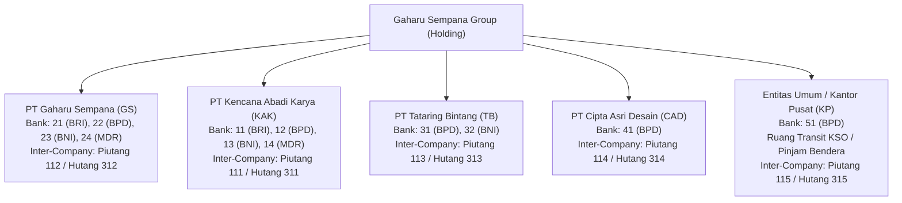
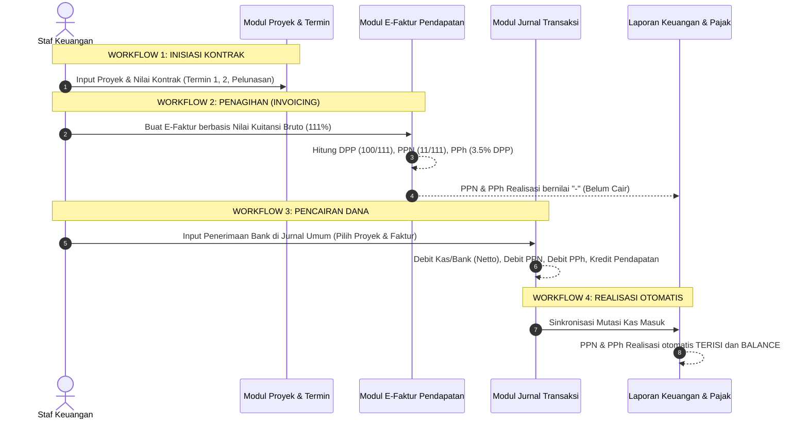

# WORKFLOW & ARSITEKTUR SISTEM KEUANGAN GAHARU SEMPANA GROUP

Dokumen ini adalah panduan arsitektur teknis, alur bisnis (*end-to-end workflow*), aturan akuntansi, dan struktur data untuk **Sistem Data Keuangan Internal Gaharu Sempana Group**. Dokumen ini dirancang agar developer baru maupun AI Coding Agent / CLI baru dapat langsung memahami cara kerja proyek tanpa kehilangan konteks.

---

## 1. Arsitektur Holding & Multi-Entitas

Sistem ini mengelola keuangan holding **Gaharu Sempana Group** yang membawahi 4 anak perusahaan (jasa konstruksi, arsitektur, perencanaan, dan pengawasan) serta 1 entitas khusus:

### Hak Akses Pengguna (RBAC)
1. **`SUPER_ADMIN`**: Akses tak terbatas ke seluruh entitas, audit log, manajemen user, dan seluruh laporan gabungan.
2. **`MANAJER_KEUANGAN`**: Approval registrasi user, melihat agregat grup ("Semua Entitas"), mereview loading dock KSO, dan mengunci laporan.
3. **`STAF_KEUANGAN`**: Terkunci pada entitas spesifik yang ditugaskan (`entityKeys`), bertanggung jawab melakukan input operasional harian (Jurnal, Kas, Faktur, Termin).
4. **`DIREKSI`**: Read-only eksekutif untuk monitoring performa, laba rugi, dan rasio keuangan.

---

## 2. Struktur Buku Besar & Aturan Akuntansi

Buku besar beroperasi dengan prinsip pencatatan **multi-leg ledger** pada tabel `Transaction`:

> Satu transaksi fisik (satu bukti transaksi) dapat terdiri dari beberapa baris di tabel `Transaction` yang saling berbagi nilai `noBukti` yang sama.

### Bagan Akun (Chart of Accounts / COA)
- **100 - Aset Lancar**: Kas Kecil, Kas Besar, Bank Operasional (11-51), Piutang Usaha, Piutang Antar Entitas (111-115).
- **200 - Aset Tetap**: Peralatan, Kendaraan, Gedung, Akumulasi Penyusutan (Garis Lurus).
- **300 - Kewajiban**: Hutang Usaha, Hutang Pajak, Hutang Antar Entitas (311-315).
- **400 - Pendapatan**: Pendapatan Jasa Konstruksi, Perencanaan, Pengawasan, dan Pendapatan Lain.
- **500 - Beban**: HPP Proyek, Beban Operasional, Beban Gaji & Honor Ahli, Potongan Pajak PPh (532-534), PPN (535-536).

### Transaksi Silang Antar Entitas (Inter-Company Crossing Entry)
Jika entitas A membayarkan biaya atau mentransfer dana untuk entitas B:
1. Pada entitas A tercatat pengeluaran kas dengan lawan akun **Piutang ke Entitas B** (Akun `11x`).
2. Sistem secara otomatis mencatat *crossing entry* pada entitas B sebagai penerimaan atau beban dengan lawan akun **Hutang ke Entitas A** (Akun `31x`).
3. Keduanya ditautkan via metadata `extraFieldsJson.crossingGroupId`.

---

## 3. Alur Kerja Bisnis End-to-End (5 Workflow Utama)

---

### Workflow 1: Manajemen Proyek & Termin (`/piutang`)
1. **Master Proyek**: Setiap proyek memiliki Kode Proyek unik (misal `gHR001`), nama klien/dinas, nilai kontrak bruto, dan status (`ACTIVE`, `COMPLETED`, `CANCELLED`).
2. **Termin Penagihan**: Nilai kontrak dipecah menjadi tahapan pembayaran (Uang Muka, Termin 1, 2, dst.).
3. **Kontrol Piutang**: Membandingkan progres fisik lapangan dengan akumulasi termin yang sudah ditagih dan dana yang sudah benar-benar masuk ke rekening bank.

---

### Workflow 2: Penerbitan E-Faktur Tagihan (`/pendapatan`)
1. **Input Utama Berbasis Nilai Kuitansi Bruto**:
   User menginput nominal kuitansi yang ditagihkan ke klien (111% nilai kuitansi bruto).
2. **Kalkulasi Pajak Otomatis**:
   - $\text{DPP} = \text{round}\left(\frac{100}{111} \times \text{Nilai Kuitansi Bruto}\right)$
   - $\text{PPN} = \text{round}\left(\frac{11}{111} \times \text{Nilai Kuitansi Bruto}\right)$
   - $\text{PPh Final} = \text{round}\left(\text{DPP} \times \text{Tarif PPh}\right) \quad (\text{Default } 3.5\% \text{ atau } 2.65\%)$
   - $\text{Laba Setelah Pajak (Net Tagihan)} = \text{DPP} - \text{PPh Final}$
3. **Dukungan Multi-Termin / Amrahan**:
   - Jika proyek memiliki riwayat penagihan sebelumnya, input `Nomor E-Faktur` berubah menjadi dropdown sederhana berisi nomor faktur lama proyek tersebut atau opsi input baru.
   - Bypass kuncian duplikasi: nomor faktur yang sama diizinkan untuk amrahan 1, 2, dst. pada proyek yang sama.
4. **Auto-Save Master Rekanan**:
   - Jika staf menginput nama atau NPWP rekanan baru, sistem otomatis mendaftarkannya ke Master Database Rekanan (`MasterRekanan`).
5. **Status Awal Faktur (Belum Cair)**:
   - Pembuatan faktur murni pencatatan tagihan administratif.
   - Kolom **PPN Realisasi**, **PPh Realisasi**, dan **Dana Cair Bank** pada Laporan Pendapatan diisi strip (`-`), dan status Balance Control bernilai **Belum Cair**.

---

### Workflow 3: Pencairan Bank & Jurnal Umum (`/jurnal-transaksi`)
1. **Input Penerimaan Kas**:
   Saat uang resmi ditransfer oleh klien/dinas ke rekening bank perusahaan, staf membuka **Entry Jurnal Transaksi** (`/jurnal-transaksi`).
2. **Pemilihan Faktur & Proyek**:
   - Staf memilih Proyek dan Faktur dari dropdown.
   - Tombol **Terapkan Baris Jurnal** otomatis menyusun 4 leg akun seimbang:
     - **Debit**: Akun Kas / Bank (Netto dana cair setelah potongan)
     - **Debit**: Akun PPN Dipungut (Akun `535`)
     - **Debit**: Akun Potongan PPh Final (Akun `534`)
     - **Kredit**: Akun Pendapatan Usaha (Akun `400`, nilai bruto kuitansi)
3. **Penomoran Bukti & Amrahan**:
   - Kolom `Nomor Bukti` bersifat opsional (jika kosong, auto-generate `JU-YYYYMMDD-XXXX`).
   - Jika nomor bukti sama dipakai berulang untuk amrahan, sistem menambahkan suffix terisolasi (`-A1`, `-A2`).
4. **Deteksi Otomatis di Laporan Pendapatan**:
   - Fungsi `extractJurnalDataForFaktur` di `src/lib/pendapatan.ts` mencocokkan transaksi jurnal berdasarkan `fakturId`, `projectId`, dan nomor bukti.
   - Begitu mutasi debit bank/pajak terdeteksi, kolom **PPN Realisasi**, **PPh Realisasi**, dan **Dana Cair Bank** di Laporan Pendapatan otomatis terisi angka riil.
   - Indikator **Balance Control** mengecek selisih: jika nominal bank masuk sesuai dengan net tagihan, badge hijau `Balance` muncul otomatis.

---

### Workflow 4: Payroll & Honor Tenaga Ahli (`/payroll`)
1. **Pegawai Tetap & Kontrak**:
   - Menghitung Gaji Pokok, Tunjangan Jabatan, Uang Makan, dan Lembur.
   - Potongan BPJS Ketenagakerjaan (JKK, JKM, JHT, JP) & BPJS Kesehatan.
   - Perhitungan **PPh 21 TER** (Tarif Efektif Rata-rata sesuai PP 58/2023) berdasarkan status PTKP (`TK/0` s.d. `K/3`).
2. **Honor Tenaga Ahli / Konsultan**:
   - Ditujukan untuk tenaga ahli lepas per proyek.
   - DPP Tenaga Ahli = $50\% \times \text{Penghasilan Bruto}$.
   - Tarif PPh 21 Pasal 17 Ayat (1) Huruf a (5% s.d. 35%).
   - Pemilik NPWP dikenakan tarif normal; non-NPWP dikenakan tarif lebih tinggi 20% (120%).
3. **Slip Gaji & Rekonsiliasi**:
   - Generate slip gaji individual per bulan.
   - Rekonsiliasi Pajak Gaji (`/rekonsiliasi-pajak-gaji`): Membandingkan akumulasi PPh 21 gaji internal dengan SPT Masa PPh 21 resmi yang dilaporkan ke DJP.

---

### Workflow 5: Laporan Keuangan & Audit Pajak (`/laporan`)
1. **Laporan Keuangan 2 Versi** (Filter `ReportCategory`):
   - **Versi Internal**: Menampilkan seluruh akun riil untuk analisis manajemen dan direksi.
   - **Versi Umum**: Menampilkan pos-pos standar akuntansi eksternal / perbankan.
2. **Komponen Laporan Utama**:
   - **Neraca**: Posisi Aset (Lancar & Tetap), Kewajiban, dan Modal.
   - **Laba Rugi**: Pendapatan, HPP Konstruksi, Beban Operasional, Beban Pajak, dan Laba Bersih.
   - **Arus Kas Presisi**: Metode langsung mengelompokkan kas masuk/keluar ke aktivitas Operasi, Investasi, dan Pendanaan.
   - **Laporan Hutang & Piutang Antar Entitas**: Matriks saldo timbal-balik inter-company antar 5 entitas.
   - **Lapis 3 Rekonsiliasi Pajak Faktur**: Membandingkan DPP & PPN faktur internal per bulan dengan nilai SPT Masa PPN yang terlapor, mendeteksi status `MATCH` atau `SELISIH`.

---

## 4. Kamus Model Data Utama (`prisma/schema.prisma`)

| Model | Fungsi Utama | Relasi Kunci |
|---|---|---|
| `Entity` | Master 5 perusahaan holding | `Project`, `Transaction`, `FakturPendapatan`, `UserEntityAccess` |
| `User` | Autentikasi & RBAC pengguna | `EntityAccess`, `Transaction (staff)`, `ActivityLog` |
| `CoaAccount` | Bagan akun buku besar | `Transaction`, `SaldoAwal` |
| `Transaction` | Jurnal umum / buku besar (single leg) | `Entity`, `CoaAccount`, `Project`, `FakturPendapatan`, `User` |
| `Project` | Master kontrak proyek | `Entity`, `Termin`, `FakturPendapatan`, `HonorTenagaAhli` |
| `Termin` | Rincian milestone termin tagihan proyek | `Project` |
| `FakturPendapatan` | E-Faktur tagihan klien bruto & pajak | `Entity`, `Project`, `Transaction` |
| `MasterRekanan` | Direktori terpusat klien, dinas, vendor | Independen / referensi nama & NPWP |
| `Pegawai` | Master data karyawan & status PTKP | `Entity`, `SlipGaji` |
| `HonorTenagaAhli` | Kompensasi & PPh 21 konsultan ahli | `Entity`, `Project` |
| `AsetTetap` | Aktiva tetap & penyusutan garis lurus | `Entity` |

---

## 5. Pedoman Khusus untuk Developer / AI Coding Agent Baru

1. **Aturan Server vs Client Component**:
   - File `src/app/(app)/<route>/page.tsx` adalah Server Component async (ambil session, query data via `src/lib/<fitur>.ts`).
   - Komponen UI interaktif (form, modal, table filter) wajib ditaruh di `src/components/<fitur>/<Fitur>Client.tsx` dengan directive `"use client"`.
2. **Mutasi Data via Server Actions**:
   - Semua operasi tulis/ubah/hapus berada di `src/lib/actions/<fitur>.ts` dengan directive `"use server"`.
   - Dipanggil dari client component menggunakan React hook `useTransition`.
3. **Standar Styling & Dark Mode**:
   - Gunakan CSS semantic token: `bg-surface-page`, `bg-surface-card`, `text-navy-text`, `text-navy-soft`, `border-border-soft`.
   - Dilarang keras memakai class Tailwind hardcoded `bg-white` polos atau hex color manual pada komponen umum.
4. **Aturan Eksekusi Perintah & Git**:
   - **Dilarang keras memakai karakter `#`** di commit message atau terminal command (karena shell zsh/bash menganggapnya komentar).
   - **Maksimal 1 file per commit** untuk menjaga riwayat git tetap granular dan mudah di-review.
   - **Dilarang menjalankan `npm run build`** atau menghapus folder `.next` saat sesi perbaikan cepat; gunakan `npx tsc --noEmit` untuk validasi tipe data.
   - **Dilarang memakai perintah `cd`** di terminal runner.
